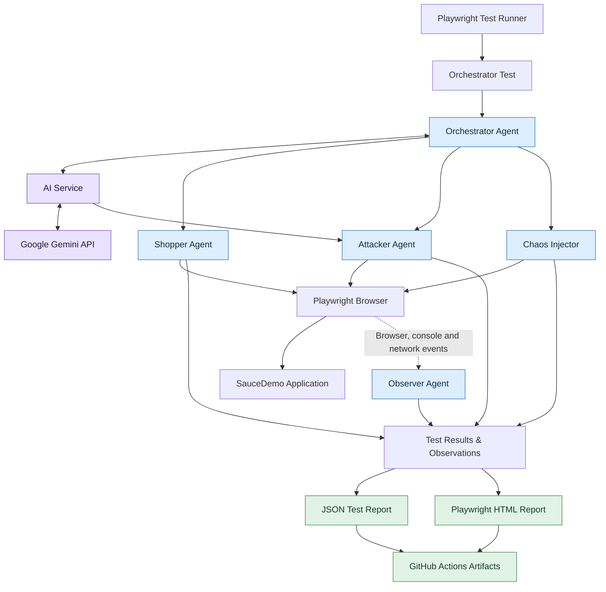

# Multi-Agent QA Automation Tester

An AI-powered QA automation framework built with **TypeScript, Playwright, and Google's Gemini AI**. It uses multiple specialized agents to automate e-commerce testing, generate edge-case inputs, test unauthorized access, simulate application failures, and monitor browser activity. A central AI-powered Orchestrator coordinates test execution, while the Observer collects errors and test evidence. The project also integrates **GitHub Actions CI/CD** for automated testing and reporting.

## Measurable Testing Outcomes

- Tracks total, passed, failed, and skipped test scenarios.

- Records individual scenario execution times.

- Counts browser errors, network failures, HTTP errors, and other observations.

- Measures the number of AI-generated test cases executed.

- Generates structured JSON and Playwright HTML reports.

   ## Project Architecture

  

